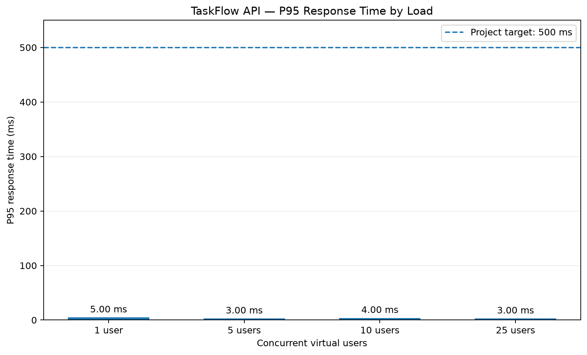

# TaskFlow API Performance Testing with Apache JMeter

[](https://github.com/cjdaprogrammer/jmeter-performance-testing/actions/workflows/ci.yml)

A QA portfolio project demonstrating API functional testing and performance testing using Apache JMeter, FastAPI, and pytest.

## Project Objectives

- Test API health and task CRUD endpoints using a reusable JMeter test plan.
- Execute baseline and concurrent-user performance tests.
- Generate JMeter HTML dashboards and analyze raw JTL results.
- Document test scope, acceptance criteria, findings, limitations, and recommendations.
- Automate performance-result analysis and generate a response-time chart.
- Integrate API functional tests and a JMeter smoke test into GitHub Actions.

## Technology Stack

- **Performance testing:** Apache JMeter 5.6.3
- **Runtime:** Java 21
- **Programming language:** Python 3.11
- **API framework:** FastAPI and Uvicorn
- **Functional testing:** pytest
- **Data visualization:** Matplotlib
- **CI/CD:** GitHub Actions

## Continuous Integration

GitHub Actions automatically runs the API functional test suite and a JMeter smoke test on pushes and pull requests targeting `main`. The workflow can also be triggered manually.

The pipeline:

1. Installs Python dependencies and runs the pytest suite.
2. Sets up Java 21 and Apache JMeter 5.6.3.
3. Starts the TaskFlow API and waits for its health endpoint.
4. Executes the JMeter test plan in non-GUI mode.
5. Verifies that JMeter produced a result file and that all recorded samples passed.
6. Uploads JMeter results and API logs as a downloadable workflow artifact.

View the [GitHub Actions workflow runs](https://github.com/cjdaprogrammer/jmeter-performance-testing/actions).

The CI smoke test validates a short execution of the test plan. It is not a substitute for the separate multi-user performance runs described below.

## Performance Test Summary

Four workloads were executed against the local TaskFlow API, with 20 loops per virtual user.

| Virtual users | Samples | Average response time | P95 response time | Errors |
|---:|---:|---:|---:|---:|
| 1 | 120 | 3.83 ms | 5 ms | 0 |
| 5 | 600 | 1.69 ms | 3 ms | 0 |
| 10 | 1,200 | 2.19 ms | 4 ms | 0 |
| 25 | 3,000 | 1.71 ms | 3 ms | 0 |
| **Total** | **4,920** | — | — | **0** |

**Project-defined acceptance criterion:** overall P95 response time of 500 ms or less.

All four recorded workloads met this criterion according to the reported results.

### P95 Response-Time Chart



### Key Observations

- All 4,920 recorded samples completed successfully in the analyzed performance runs.
- Reported P95 response times ranged from 3 to 5 ms.
- The single-user run included a 94 ms maximum response time for the health-check sampler. Its cause has not been established.
- Throughput did not increase consistently at every workload level.
- The recorded response times were below the project-defined 500 ms P95 threshold.

These measurements were collected during short-duration tests against a local API using in-memory storage. They do not establish production capacity or guarantee performance under sustained, distributed, or real-world network conditions.

## Repository Structure

```text
jmeter-performance-testing/
├── .github/
│   └── workflows/
│       └── ci.yml
├── app/
├── tests/
├── test-plans/
├── test-data/
├── results/                  # Local JTL results; Git-ignored
├── reports/                  # Generated reports; Git-ignored
├── docs/
│   ├── screenshots/
│   │   └── p95-response-time.png
│   ├── test-plan.md
│   ├── performance-test-report.md
│   ├── performance-analysis.md
│   └── test-environment.md
├── scripts/
│   ├── analyze_jmeter_results.py
│   └── generate_performance_chart.py
├── requirements.txt
└── README.md
```

## Prerequisites

Install or configure the following tools:

- Python 3.11
- Java 21
- Apache JMeter 5.6.3
- Git

The commands below use PowerShell and assume JMeter is installed at:

`%USERPROFILE%\Downloads\apache-jmeter-5.6.3\apache-jmeter-5.6.3\bin\jmeter.bat`

Adjust the path if your installation is located elsewhere.

## Setup

Run these commands from the project root.

### 1. Activate the virtual environment

If you have already created `.venv`:

```powershell
.\.venv\Scripts\Activate.ps1
```

If you have not created it yet:

```powershell
python -m venv .venv
.\.venv\Scripts\Activate.ps1
```

### 2. Install Python dependencies

```powershell
python -m pip install -r requirements.txt
```

### 3. Create local output directories

```powershell
New-Item -ItemType Directory -Force results, reports | Out-Null
```

Generated JTL results and HTML reports are intended for local analysis and are excluded from Git by `.gitignore`.

## Start the API

From the project root, start the FastAPI application:

```powershell
python -m uvicorn app.main:app --host 127.0.0.1 --port 8000
```

The API should be available at:

- Health endpoint: `http://127.0.0.1:8000/health`
- API base URL: `http://127.0.0.1:8000`

Keep the API running in its own terminal while executing local JMeter tests.

## Run Functional API Tests

In a second terminal, activate the virtual environment if needed and run:

```powershell
python -m pytest -v
```

The current functional test suite contains 11 tests covering health checks and task CRUD behavior, including missing-resource and invalid-title cases.

## Run JMeter Tests

The reusable test plan is:

`test-plans/taskflow-baseline.jmx`

The plan supports configurable thread count, ramp-up time, and loop count through JMeter properties.

### Baseline test: one virtual user

```powershell
& "$env:USERPROFILE\Downloads\apache-jmeter-5.6.3\apache-jmeter-5.6.3\bin\jmeter.bat" `
  -n `
  -t "test-plans\taskflow-baseline.jmx" `
  -Jthreads=1 `
  -Jrampup=1 `
  -Jloops=20 `
  -l "results\baseline-20-loops.jtl" `
  -e `
  -o "reports\baseline-20-loops"
```

### Concurrent-user test: 25 virtual users

```powershell
& "$env:USERPROFILE\Downloads\apache-jmeter-5.6.3\apache-jmeter-5.6.3\bin\jmeter.bat" `
  -n `
  -t "test-plans\taskflow-baseline.jmx" `
  -Jthreads=25 `
  -Jrampup=30 `
  -Jloops=20 `
  -l "results\load-25-users-20-loops.jtl" `
  -e `
  -o "reports\load-25-users-20-loops"
```

**Important:** Keep each JTL filename unique. JMeter's `-o` report output directory must be empty or not exist before generating a dashboard. If you rerun a test, choose a new report directory or remove the previous generated report directory first.

The examples assume the API is already running locally and that the JMeter installation path matches your machine.

### Open a generated HTML dashboard

For the 25-user example:

```powershell
Start-Process ".\reports\load-25-users-20-loops\index.html"
```

The dashboard provides a visual overview of the generated test results.

## Analyze Results and Generate the Chart

After generating the required JTL files, run the analysis script:

```powershell
python .\scripts\analyze_jmeter_results.py
```

Generate the P95 response-time chart:

```powershell
python .\scripts\generate_performance_chart.py
```

The analysis script reports overall and per-sampler metrics. The chart-generation script calculates P95 response times from the available raw JTL results and writes the chart to:

`docs/screenshots/p95-response-time.png`

Run these scripts after producing the input results they expect. Confirm that the input JTL files correspond to the workloads you want to analyze before updating the documented metrics.

## Documentation

- [Performance test plan](docs/test-plan.md)
- [Performance test report](docs/performance-test-report.md)
- [Performance analysis](docs/performance-analysis.md)
- [Test environment](docs/test-environment.md)
- [JMeter result analysis script](scripts/analyze_jmeter_results.py)
- [Chart generation script](scripts/generate_performance_chart.py)
- [GitHub Actions workflow](.github/workflows/ci.yml)

## Limitations

- The API uses in-memory storage, so data resets when the application process restarts.
- Localhost testing does not represent real network latency or a production deployment.
- Short-duration tests do not establish endurance stability or maximum safe concurrency.
- The 500 ms threshold is a project-defined target, not an externally validated service-level objective.
- Zero recorded sample errors should be evaluated alongside response assertions and per-sampler results.
- The reported measurements do not demonstrate how the API behaves with persistent database storage, distributed load generators, or production infrastructure.

## Future Improvements

Potential next steps include:

- Integrating persistent database storage and testing its impact on performance.
- Running longer-duration load and endurance tests.
- Monitoring CPU, memory, and other resource metrics during execution.
- Comparing response times and throughput across repeated test runs.
- Expanding CI to include additional performance thresholds and historical trend tracking.

## Conclusion

This project demonstrates a reproducible introduction to API functional testing, performance testing with Apache JMeter, automated result analysis, and CI integration.

The recorded local test runs met the project's defined P95 response-time criterion. Further monitored, database-backed, longer-duration, and distributed testing would be necessary before drawing conclusions about production scalability.